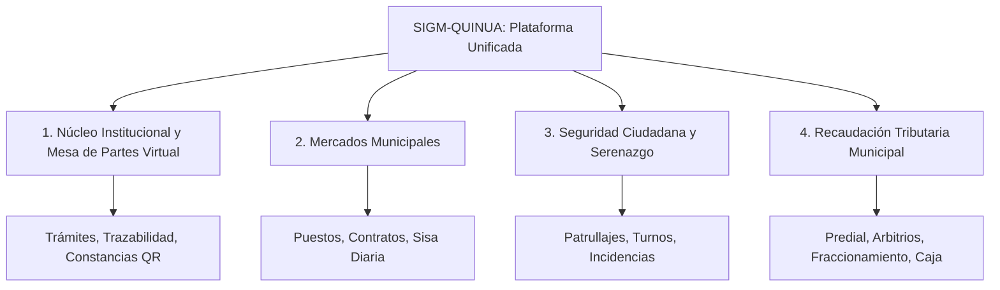

# 01. DESCRIPCIÓN GENERAL DEL SISTEMA — SIGM-QUINUA

## 1. Identificación y Finalidad Institucional
* **Nombre del Sistema:** Sistema Integral de Gestión Municipal de Quinua (**SIGM-QUINUA**).
* **Entidad Requiriente:** Municipalidad Distrital de Quinua, Provincia de Huamanga, Departamento de Ayacucho, Perú (Ubigeo: `050108`).
* **Finalidad:** Digitalizar, unificar, controlar y optimizar la administración pública local mediante un sistema integrado de gobierno electrónico que centraliza la atención al ciudadano, el control de mercados, la seguridad ciudadana y la recaudación de tributos distritales.

---

## 2. Contexto Territorial y Operativo
El Distrito de Quinua, reconocido históricamente como la *Capital de la Independencia Americana* y cuna de artesanos alfareros, presenta particularidades geográficas y socioeconómicas:
* **Ubicación:** Valle interandino a 3,396 m.s.n.m., con centros poblados y comunidades campesinas dispersas.
* **Actividades Principales:** Turismo histórico (Santuario Histórico de la Pampa de Ayacucho), alfarería tradicional, comercio en ferias dominicales y agricultura familiar.
* **Problemática Administrativa Previa:** Procesamiento de expedientes en papel físico con alto riesgo de extravío, ausencia de cobro sistematizado en los puestos comerciales, falta de registro georreferenciado y tipificado de intervenciones de serenazgo, y morosidad tributaria elevada por falta de cuenta corriente consolidada.

---

## 3. Alcance del Sistema (Los 4 Servicios Autorizados)

### Servicio 1: Núcleo del Sistema y Mesa de Partes Virtual
* Catálogo de procedimientos TUPA y no TUPA.
* Radicación presencial y virtual con código correlativo anual (`EXP-YYYY-NNNNNN`).
* Derivaciones inter-oficinas con plazos de ley (Ley N° 27444).
* Constancias digitales de recepción con código QR de verificación pública y huella criptográfica SHA-256.

### Servicio 2: Mercados Municipales
* Padrón de mercados (Mercado Central de Quinua, feria artesanal), sectores, pabellones y puestos.
* Padrón de comerciantes individuales y personas jurídicas.
* Asignación de puestos con validación estricta de exclusividad.
* Emisión de contratos, control de obligaciones, cobro de sisa diaria y merced conductiva mensual.

### Servicio 3: Seguridad Ciudadana y Serenazgo
* Programación de cuadrantes, sectores y turnos de personal de serenazgo.
* Asignación de flota vehicular y equipamiento.
* Registro de incidencias ciudadanas y despacho de auxilio.
* Protección de datos sensibles de denunciantes y menores según Ley N° 29733.

### Servicio 4: Recaudación Tributaria Municipal
* Padrón de contribuyentes y base catastral de predios.
* Emisión anual de Impuesto Predial y Arbitrios Municipales (Limpieza Pública, Parques y Jardines, Serenazgo).
* Cuenta corriente con liquidación de intereses moratorios (TIM).
* Fraccionamiento tributario en cuotas con resolución de alcaldía.
* Apertura, cobro, anulación y arqueo diario de caja municipal.

---

## 4. Stack Tecnológico Oficial

| Componente | Tecnología | Versión | Rol en el Sistema |
| :--- | :--- | :---: | :--- |
| **Lenguaje** | Java (OpenJDK) | 17 LTS | Lenguaje base tipado y seguro |
| **Framework Web** | Spring Boot | 4.1.1 | Inyección de dependencias, MVC y configuración |
| **Seguridad** | Spring Security | 6.x | Autenticación, RBAC y CSRF |
| **Persistencia** | Spring Data JPA / Hibernate | 7.x | Mapeo objeto-relacional y transacciones ACID |
| **Base de Datos** | PostgreSQL | 17 | Almacén relacional principal (puerto 5433) |
| **Migraciones** | Flyway Community | 12.x | Versionamiento de base de datos (V1 a V67) |
| **Vistas Web** | Thymeleaf + Layout Dialect | 3.x | Renderizado seguro de vistas en servidor |
| **Diseño Frontend** | Tailwind CSS | 3.4 | Sistema de diseño institucional local |
| **Iconografía** | Lucide Icons | Local UMD | Simbología SVG sin conexión externa |
| **Reportes Excel** | Apache POI | 5.4 | Generación y exportación de hojas de cálculo |
| **Reportes PDF** | OpenPDF (LibrePDF) | 2.0.3 | Documentos oficiales y comprobantes con QR |
| **Pruebas** | JUnit 5, Mockito, MockMvc | 5.x / 6.x | Automatización y aseguramiento QA |

---

## 5. Limitaciones y Restricciones
* El sistema opera en arquitectura de **Monolito Modular** en un solo proceso Java ejecutable.
* No se contemplan pasarelas de pago bancario en línea con débito automático por falta de convenio bancario directo con la municipalidad en esta fase; los pagos se registran en ventanilla de caja o contra voucher verificado.
* No se utilizan microservicios ni brokers de mensajería externos (Kafka/RabbitMQ) para evitar sobrecarga operativa y costos de infraestructura incompatibles con el presupuesto municipal.

