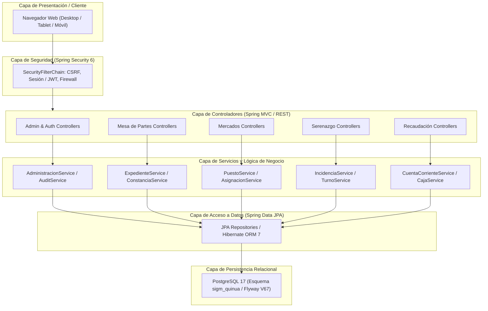

# 03. ARQUITECTURA DEL SISTEMA — SIGM-QUINUA

## 1. ESTILO ARQUITECTÓNICO: MONOLITO MODULAR

SIGM-QUINUA adopta el patrón de **Monolito Modular** estructurado en capas. Este enfoque combina las ventajas de desarrollo, despliegue unificado y consistencia transaccional ACID de un monolito, con la estricta separación de responsabilidades y bajo acoplamiento propios de una arquitectura orientada a dominios.

### Principios Fundamentales:
1. **Unidad de Despliegue:** Un único archivo JAR ejecutable que contiene todos los módulos y recursos web.
2. **Base de Datos Unificada con Esquema Relacional:** Una única base de datos PostgreSQL 17 (`sigm_quinua`), garantizando consistencia referencial y transaccional sin necesidad de protocolos de coordinación distribuida (2PC o Sagas complejas).
3. **Aislamiento por Paquetes de Dominio:** Cada uno de los cuatro servicios municipales reside en su propio paquete base con capas independientes de controladores, servicios, repositorios y entidades.
4. **Flujo Canónico por Capas:** Las peticiones siguen estrictamente la dirección descendente:
   `Controlador Web/API` → `Servicio de Aplicación/Dominio` → `Repositorio Spring Data JPA` → `Entidad / PostgreSQL`.

---

## 2. DIAGRAMA ARQUITECTÓNICO EN CAPAS

---

## 3. DESCRIPCIÓN DE CAPAS Y RESPONSABILIDADES

### A. Capa de Seguridad (Spring Security 6)
* Intercepta todas las solicitudes entrantes mediante una cadena de filtros (`SecurityFilterChain`).
* Valida tokens CSRF en solicitudes mutativas `POST`, `PUT`, `DELETE`.
* Gestiona sesiones de usuario basadas en cookies con indicador `HttpOnly` y `SameSite=Strict`.
* Proporciona soporte para tokens JWT en endpoints REST auxiliares.
* Aplica autorización basada en roles (RBAC) y evaluadores de permisos a nivel de método (`@PreAuthorize`).

### B. Capa de Controladores (Web MVC y REST APIs)
* **Web Controllers (`*WebController`):** Procesan peticiones del navegador, inyectan atributos en el modelo (`Model`) y retornan el nombre lógico de las plantillas Thymeleaf.
* **API Controllers (`*ApiController`):** Exponen endpoints RESTful que consumen y producen JSON para operaciones asíncronas frontend (e.g., búsquedas dinámicas de contribuyentes, autocompletado de giros comerciales, métricas de gráficos).
* **Validación de Entrada:** Aplica `@Valid` sobre DTOs mediante Jakarta Bean Validation antes de invocar a los servicios.

### C. Capa de Servicios de Negocio (`@Service`)
* Encapsula las reglas operativas de la Municipalidad de Quinua (cálculo de interés de fraccionamientos, correlación de expedientes, disponibilidad de puestos de mercado).
* Delimita las transacciones mediante `@Transactional` (con `rollbackFor = Exception.class`).
* Aplica auditoría registrando acciones en la bitácora administrativa (`AuditoriaAdministrativaService`).

### D. Capa de Repositorios (`@Repository`)
* Extiende de `JpaRepository<T, ID>` de Spring Data JPA.
* Implementa consultas derivadas seguras por nombres de métodos y consultas JPQL/SQL nativo con `@Query` parametrizadas para evitar inyección SQL.

### E. Entidades de Dominio (`@Entity`)
* Modelan las tablas de PostgreSQL. Heredan de `AuditableEntity` para registrar automáticamente marcas de tiempo y usuario autor (`createdAt`, `updatedAt`, `createdBy`, `updatedBy`).

---

## 4. PATRONES DE DISEÑO UTILIZADOS

| Patrón | Propósito en SIGM-QUINUA |
| :--- | :--- |
| **Data Transfer Object (DTO)** | Desacoplar las entidades JPA de la capa de presentación y evitar sobreexposición de campos sensibles. |
| **Builder Pattern (Lombok)** | Construcción inmutable y limpia de objetos de dominio y respuestas DTO complejas. |
| **Repository Pattern** | Abstracción del acceso a datos en la base de datos PostgreSQL. |
| **Strategy Pattern** | Selección dinámica de cálculo de liquidación tributaria según el tipo de arbitrio o impuesto. |
| **Template Method** | Generación documental estandarizada de constancias y recibos en PDF con encabezado y pie común. |

