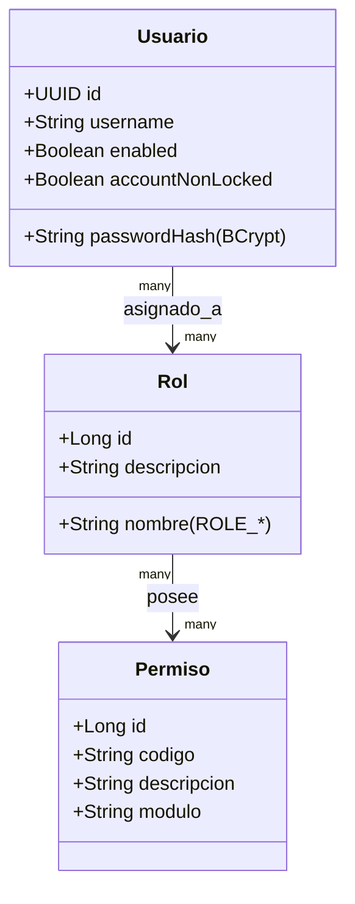

# 06. SEGURIDAD, AUTENTICACIÓN Y AUTORIZACIÓN — SIGM-QUINUA

## 1. MODELO DE CONTROL DE ACCESO BASADO EN ROLES (RBAC)

SIGM-QUINUA implementa una política estricta de autorización basada en roles (RBAC) gestionada mediante Spring Security. Ningún usuario puede acceder a funcionalidades o vistas sin contar explícitamente con el rol requerido.

### Matriz de Roles y Alcance Institucional:

| Rol Oficial | Descripción y Ámbito de Control |
| :--- | :--- |
| `ROLE_SUPERADMIN` | Acceso global irrestricto, configuración del sistema, auditoría forense y gestión de TI. |
| `ROLE_ADMIN` | Gerencia municipal, monitoreo de dashboards institucionales y reportes consolidados. |
| `ROLE_MESA_PARTES` | Recepción, radicación, foliación digital, derivación y notificación de expedientes. |
| `ROLE_OFICINA` | Bandeja de entrada de área de destino, proveídos, actuaciones y emisión de resoluciones. |
| `ROLE_MERCADOS` | Administración de puestos, empadronamiento de comerciantes y control de contratos de mercado. |
| `ROLE_SERENAZGO_SUPERVISOR` | Despacho de unidades móviles, programación de turnos y aprobación de partes de serenazgo. |
| `ROLE_SERENO` | Registro de incidencias en campo y patrullaje preventivo en sectores del distrito. |
| `ROLE_CAJERO` | Apertura de caja, cobro en ventanilla, emisión de recibos y arqueo diario de efectivo. |
| `ROLE_RENTAS` | Determinación de predial y arbitrios, liquidación de TIM, convenios de fraccionamiento y coactiva. |
| `ROLE_CIUDADANO` | Portal ciudadano: presentación de trámites virtuales y seguimiento con código único. |
| `ROLE_COMERCIANTE` | Portal del comerciante: consulta de canon de puesto, récord de pagos y contrato. |
| `ROLE_CONTRIBUYENTE` | Portal tributario: consulta de predios declarados, cuenta corriente y constancias. |

---

## 2. MECANISMOS DE AUTENTICACIÓN Y PROTECCIÓN DE CREDENCIALES

* **Algoritmo de Hashing:** BCrypt con factor de costo 12 (`BCryptPasswordEncoder`).
* **Protección contra Fuerza Bruta:** Bloqueo automático de cuenta tras 5 intentos fallidos consecutivos de inicio de sesión durante un período de 15 minutos.
* **Sesiones Web Seguras:**
  * Indicador `HttpOnly` activo para mitigar robo de sesión mediante ataques XSS.
  * Directiva `SameSite=Strict` para prevenir falsificación de peticiones en sitios cruzados.
  * Regeneración de ID de sesión (`sessionFixation().newSession()`) tras la autenticación exitosa.

---

## 3. PROTECCIÓN CONTRA VULNERABILIDADES OWASP TOP 10

1. **Inyección SQL (SQLi):**
   * Eliminación absoluta de concatenación manual de cadenas en consultas.
   * Uso exclusivo de consultas JPA y `@Query` parametrizadas en Spring Data.
2. **Cross-Site Scripting (XSS):**
   * Escape HTML automático por defecto en todas las expresiones de Thymeleaf (`th:text`).
   * Sanitización de entradas de texto libre mediante expresiones regulares.
3. **Cross-Site Request Forgery (CSRF):**
   * Tokens CSRF sincronizados obligatorios en todos los formularios de envío `POST`, `PUT` y `DELETE` (`_csrf`).
4. **Control de Acceso a Nivel de Objeto Inseguro (IDOR):**
   * Validación de propiedad de recursos en el servicio (`validarPropietarioOAccesoAutorizado`). Los ciudadanos y comerciantes autenticados únicamente pueden acceder a registros asociados a su propio identificador de persona o usuario.
5. **Inyección de Fórmulas en Hojas de Cálculo (Formula Injection):**
   * Sanitización activa en `ReporteFilterHelper.sanitizarParaExcel` anteponiendo apóstrofe (`'`) a campos que inicien con caracteres de ejecución (`=`, `+`, `-`, `@`, `\t`, `\r`).

---

## 4. PROTECCIÓN DE DATOS PERSONALES (LEY N° 29733)
* En el módulo de serenazgo, los nombres, domicilios y teléfonos de víctimas de violencia o denunciantes son automáticamente enmascarados en las pantallas y reportes generales (`"J*** P*** C***"`).
* Los datos de menores de edad involucrados en incidencias quedan bajo estricta reserva, accesibles exclusivamente mediante credenciales del supervisor o requerimiento fiscal acreditado.

