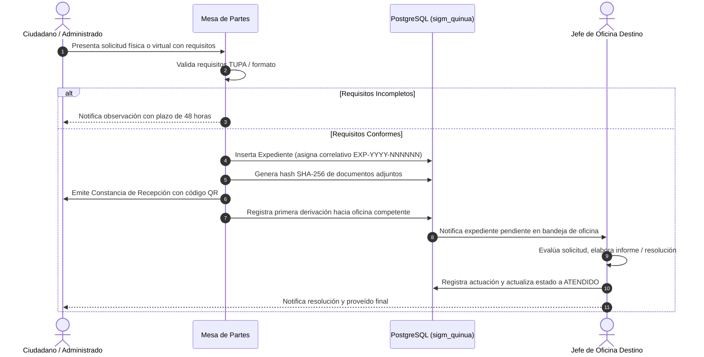
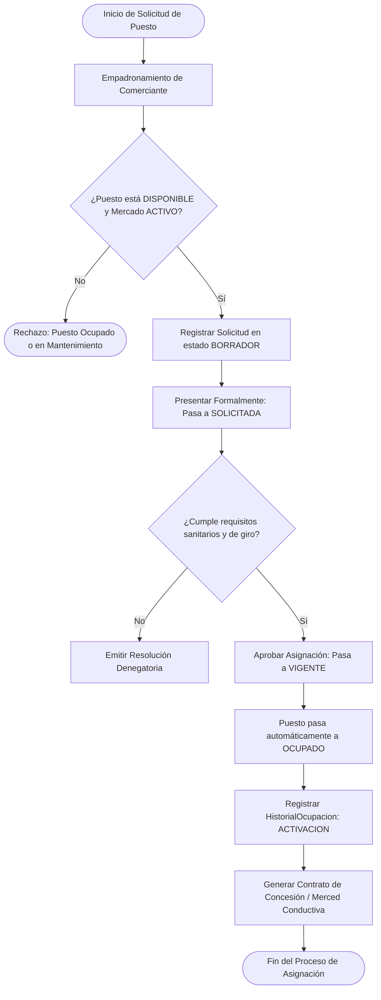
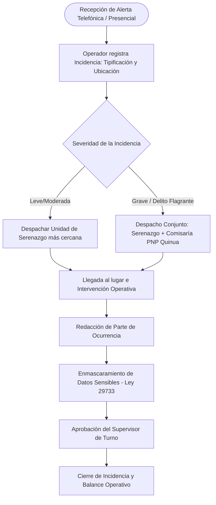
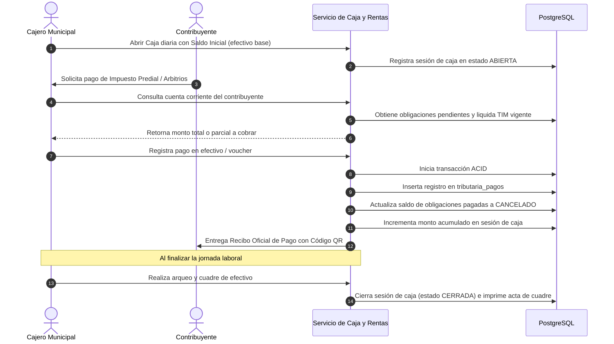

# 08. PROCESOS DE NEGOCIO INSTITUCIONALES — SIGM-QUINUA

## 1. PROCESO DE MESA DE PARTES Y TRÁMITE DOCUMENTARIO

El flujo de atención de trámites documentarios se rige bajo la Ley N° 27444 (Ley del Procedimiento Administrativo General):

---

## 2. PROCESO DE ASIGNACIÓN DE PUESTOS EN MERCADOS MUNICIPALES

---

## 3. PROCESO DE GESTIÓN Y DESPACHO DE INCIDENCIAS DE SERENAZGO

---

## 4. PROCESO DE CAJA Y RECAUDACIÓN TRIBUTARIA MUNICIPAL

