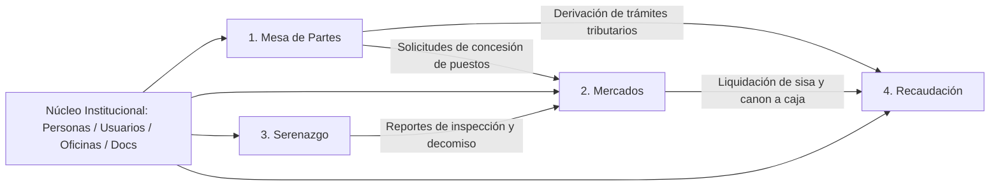

# 09. INTEGRACIÓN Y COMUNICACIÓN MODULAR — SIGM-QUINUA

## 1. MODELO DE INTEGRACIÓN MODULAR EN UN SOLO PROCESO

En cumplimiento de la directiva de diseño de **Monolito Modular**, los cuatro servicios municipales no se comunican mediante HTTP remoto ni RPC distribuido, sino mediante:
1. **Invocación Directa de Servicios Java:** Interfaces de servicios transaccionales protegidas por el contexto de Spring.
2. **Tablas Compartidas de Dominio Transversal:** Las tablas del núcleo institucional (`personas`, `usuarios`, `oficinas`, `documentos`) son consumidas directamente por los módulos mediante Spring Data JPA.
3. **Consistencia Transaccional ACID Compartida:** Cuando una operación involucra múltiples módulos (e.g., cobro de canon de mercado en ventanilla de caja), la transacción `@Transactional` de Spring cubre todas las operaciones en la base de datos PostgreSQL, garantizando rollback atómico si ocurre un fallo.

---

## 2. PUNTOS DE ARTICULACIÓN ENTRE LOS CUATRO SERVICIOS

### A. Integración Mercados Municipales → Recaudación Tributaria
* **Flujo Operativo:** Cuando un comerciante adjudicatario debe pagar la tasa diaria de sisa o la merced conductiva mensual de su puesto comercial:
  * El módulo de Mercados genera el concepto de cobro referenciando al titular del puesto.
  * El cajero en el módulo de Recaudación busca al comerciante por DNI/RUC o código de puesto.
  * Al confirmarse el cobro en ventanilla, se asienta el ingreso en la sesión de caja del día y se emite el comprobante tributario municipal.
  * El módulo de Mercados actualiza el récord de cumplimiento del comerciante sin deudas pendientes.

### B. Integración Mesa de Partes → Oficinas de Destino (Mercados, Serenazgo, Rentas)
* **Flujo Operativo:** Un administrado ingresa una solicitud formal (e.g., reclamo de arbitrios, solicitud de adjudicación de puesto, denuncia vecinal):
  * Mesa de Partes radíca el expediente y genera el código institucional `EXP-YYYY-NNNNNN`.
  * La primera derivación enruta el expediente a la bandeja interna de la oficina de Rentas, Mercados o Seguridad Ciudadana.
  * El funcionario de dicha área atiende el expediente, adjunta el informe técnico correspondiente y lo devuelve con proveído para emisión de resolución de alcaldía o decreto municipal.

### C. Dashboard Institucional Centralizado
* El servicio `DashboardServiceImpl` consolida en un único panel de control gerencial las métricas en tiempo real de los 4 servicios:
  * Expedientes en trámite desde `mesa_partes_expedientes`.
  * Ocupación y disponibilidad de puestos desde `mercados_puestos`.
  * Incidencias atendidas del mes desde `serenazgo_incidencias`.
  * Monto recaudado del día y porcentaje de meta desde `tributaria_pagos`.

