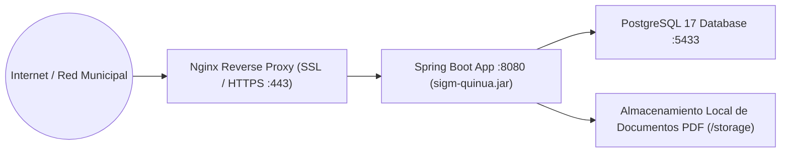

# 12. GUÍA DE DESPLIEGUE EN SERVIDORES — SIGM-QUINUA

## 1. PREPARACIÓN DEL ARTEFACTO EJECUTABLE

El despliegue institucional de SIGM-QUINUA se realiza a partir de un **Fat JAR** autocontenido generado mediante el plugin de Spring Boot.

### Comando de Empaquetado:
```powershell
.\mvnw.cmd package -DskipTests
```
* **Ubicación del Artefacto Generado:**  
  `target/sigm-quinua-0.0.1-SNAPSHOT.jar`
* **Tamaño aproximado:** 95 MB (incluye Tomcat embebido, todas las dependencias Java y los recursos estáticos web).

---

## 2. TOPOLOGÍA DE PRODUCCIÓN RECOMENDADA



---

## 3. DESPLIEGUE COMO SERVICIO EN LINUX (SYSTEMD)

Cree el archivo de definición de servicio en `/etc/systemd/system/sigm-quinua.service`:

```ini
[Unit]
Description=SIGM-QUINUA - Sistema Integral de Gestion Municipal
After=network.target postgresql.service

[Service]
User=sigm
Group=sigm
Type=simple
Environment="SPRING_PROFILES_ACTIVE=prod"
Environment="DB_HOST=127.0.0.1"
Environment="DB_PORT=5433"
Environment="DB_NAME=sigm_quinua"
Environment="DB_USERNAME=sigm_user"
Environment="DB_PASSWORD=ClaveSeguraProduccion2026!"
ExecStart=/usr/bin/java -Xms1024m -Xmx2048m -jar /opt/sigm-quinua/sigm-quinua-0.0.1-SNAPSHOT.jar
Restart=always
RestartSec=10

[Install]
WantedBy=multi-user.target
```

### Comandos de Activación:
```bash
sudo systemctl daemon-reload
sudo systemctl enable sigm-quinua
sudo systemctl start sigm-quinua
sudo systemctl status sigm-quinua
```

---

## 4. CONFIGURACIÓN DEL REVERSE PROXY NGINX (HTTPS)

```nginx
server {
    listen 80;
    server_name sigm.muniquinua.gob.pe;
    return 301 https://$host$request_uri;
}

server {
    listen 443 ssl http2;
    server_name sigm.muniquinua.gob.pe;

    ssl_certificate /etc/letsencrypt/live/sigm.muniquinua.gob.pe/fullchain.pem;
    ssl_certificate_key /etc/letsencrypt/live/sigm.muniquinua.gob.pe/privkey.pem;

    client_max_body_size 25M;

    location / {
        proxy_pass http://127.0.0.1:8080;
        proxy_set_header Host $host;
        proxy_set_header X-Real-IP $remote_addr;
        proxy_set_header X-Forwarded-For $proxy_add_x_forwarded_for;
        proxy_set_header X-Forwarded-Proto $scheme;
    }
}
```

---

## 5. PLAN DE ROLLBACK EN CASO DE INCIDENTES
1. Detener el servicio: `sudo systemctl stop sigm-quinua`.
2. Restaurar el archivo `.jar` anterior desde la copia de respaldo: `/opt/sigm-quinua/backups/sigm-quinua-previo.jar`.
3. Si la actualización incluyó cambios en la base de datos, restaurar el dump de PostgreSQL previo a la migración.
4. Iniciar el servicio y verificar el endpoint `/actuator/health` o la pantalla de login `/login`.

