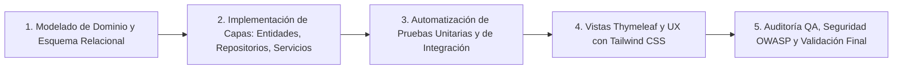

# METODOLOGÍA DE DESARROLLO APLICADA — SIGM-QUINUA

## 1. ENFOQUE METODOLÓGICO: DESARROLLO ÁGIL GUIADO POR DOMINIOS (DDD + TDD LIGERO)

El proyecto SIGM-QUINUA se ejecutó combinando las prácticas del **Diseño Guiado por el Dominio (Domain-Driven Design - DDD)** con un enfoque iterativo e incremental basado en **80 fases sistemáticas de construcción y aseguramiento de calidad**.

---

## 2. ETAPAS DEL CICLO DE VIDA DEL PROYECTO

### Etapa 1: Análisis y Modelado Conceptual de Dominio
* Mapeo de los cuatro servicios esenciales de la Municipalidad Distrital de Quinua.
* Definición del Lenguaje Ubicuo (*Ubiquitous Language*): términos institucionales exactos como *expediente*, *proveído*, *actuación*, *merced conductiva*, *sisa*, *arbitrios*, *cuadrante de serenazgo*, *TIM*.
* Diseño del esquema relacional y particionamiento en migraciones Flyway (V1 a V67).

### Etapa 2: Construcción Modular e Integración Vertical
* Implementación de entidades de persistencia JPA con herencia de auditoría común (`AuditableEntity`).
* Creación de servicios transaccionales con lógica de negocio encapsulada y validación de invariantes.
* Desarrollo de controladores web MVC y APIs REST para consumo dinámico.
* Diseño de interfaces responsivas y accesibles utilizando Tailwind CSS e iconografía local Lucide Icons.

### Etapa 3: Aseguramiento de Calidad y Pruebas Continuas
* Implementación de pruebas automatizadas con JUnit 5 y Mockito para la lógica de cálculo y servicios.
* Ejecución de pruebas de integración web con `MockMvc` para verificar la seguridad, CSRF y RBAC.
* Pruebas de integración sobre PostgreSQL 17 real validando transacciones ACID, integridad referencial y bloqueos concurrentes.
* Corrección y regresión exhaustiva hasta alcanzar el 100% de éxito en 1,255 pruebas.

