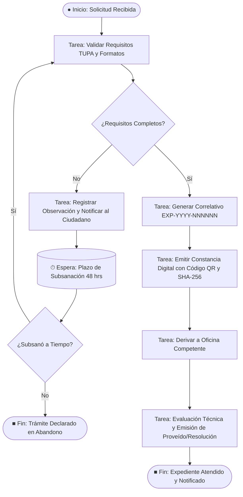
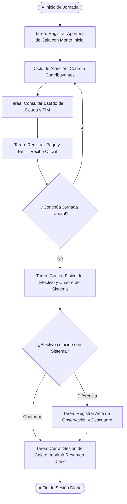

# PROCESOS DE NEGOCIO BPMN — SIGM-QUINUA

Modelado de los procesos institucionales conforme al estándar BPMN 2.0 (Business Process Model and Notation).

---

## 1. PROCESO BPMN: RADICACIÓN Y DERIVACIÓN EN MESA DE PARTES

---

## 2. PROCESO BPMN: APERTURA, COBRO Y ARQUEO DIARIO DE CAJA

