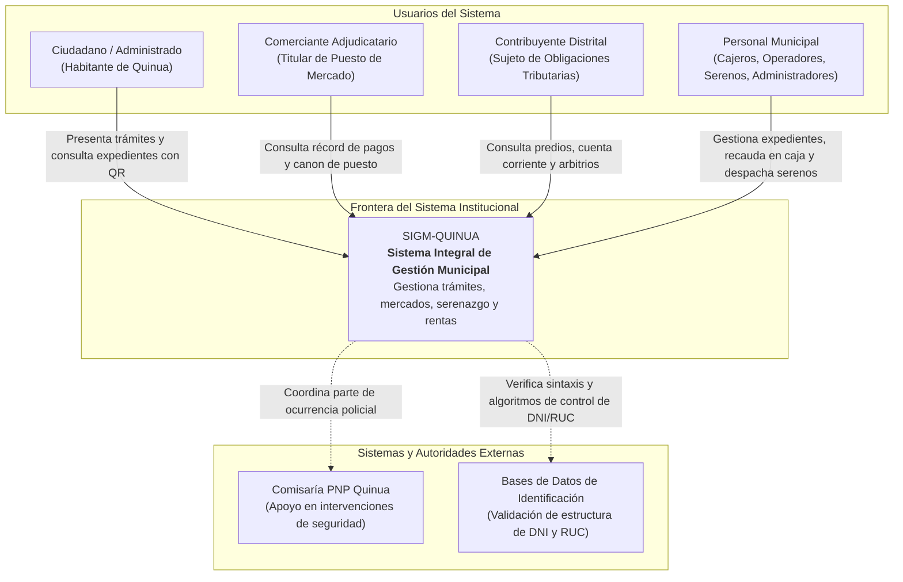
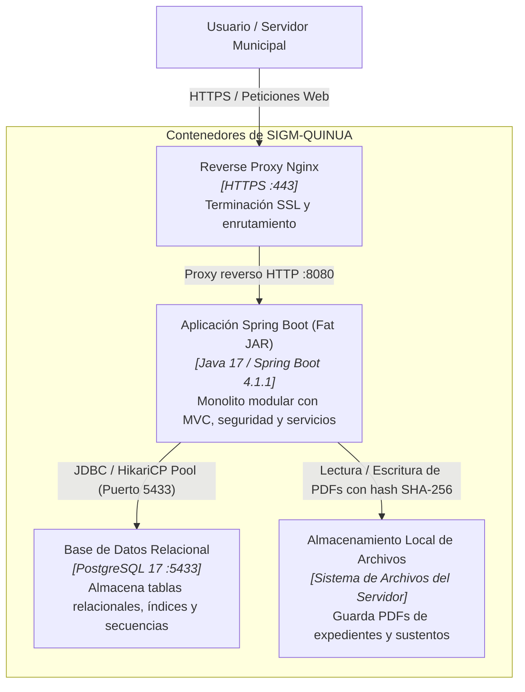
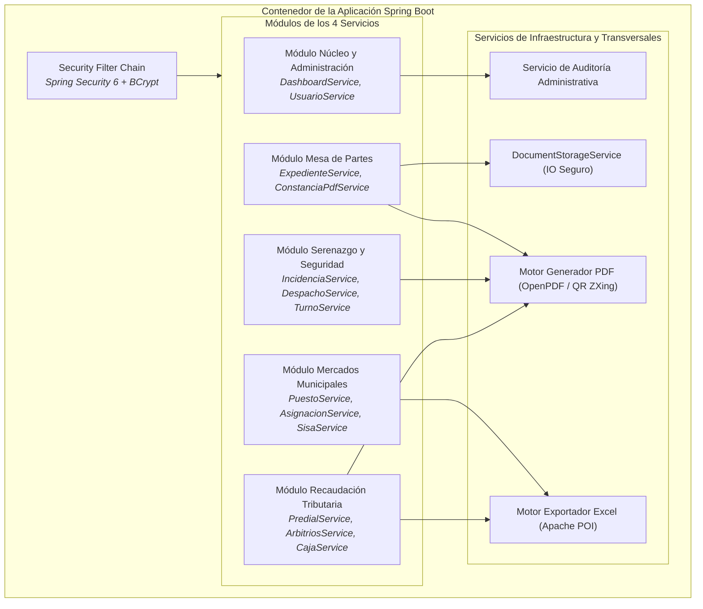

# DIAGRAMAS C4 — MODELO DE ARQUITECTURA DE SOFTWARE SIGM-QUINUA

El modelo C4 permite describir la arquitectura de SIGM-QUINUA en diferentes niveles de abstracción: Contexto del Sistema (Nivel 1), Contenedores (Nivel 2) y Componentes (Nivel 3).

---

## 1. NIVEL 1: DIAGRAMA DE CONTEXTO DEL SISTEMA

Muestra cómo SIGM-QUINUA se relaciona con sus usuarios humanos (ciudadanos y servidores municipales) y con entidades externas reales.

---

## 2. NIVEL 2: DIAGRAMA DE CONTENEDORES

Muestra las unidades ejecutables y de almacenamiento que componen la solución.

---

## 3. NIVEL 3: DIAGRAMA DE COMPONENTES DEL MONOLITO MODULAR

Muestra los principales componentes Java dentro de la aplicación Spring Boot.

