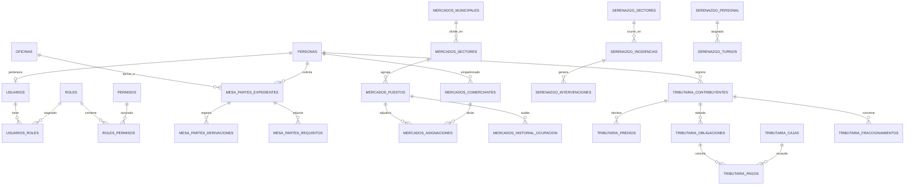

# DIAGRAMA ENTIDAD-RELACIÓN (DER) — BASE DE DATOS POSTGRESQL 17 SIGM-QUINUA

Representación del modelo de datos relacional implementado en PostgreSQL (`sigm_quinua`), gestionado mediante Flyway V1 a V67.

---

## 1. DESCRIPCIÓN DE ENTIDADES CLAVE

* **`USUARIOS` / `ROLES` / `PERMISOS`:** Núcleo de autenticación y autorización RBAC. Claves primarias numéricas y UUIDs en usuarios.
* **`MESA_PARTES_EXPEDIENTES`:** Almacena el número único de expediente `EXP-YYYY-XXXXXX`, fecha, estado y código de seguridad para seguimiento público.
* **`MERCADOS_PUESTOS` / `MERCADOS_ASIGNACIONES`:** Registra las características físicas de los puestos y los contratos vigentes de los comerciantes con control de unicidad.
* **`SERENAZGO_INCIDENCIAS`:** Registra la tipificación, coordenadas georreferenciadas, estado y partes de ocurrencia en PDF.
* **`TRIBUTARIA_OBLIGACIONES` / `TRIBUTARIA_PAGOS`:** Controla la cuenta corriente, emisión de cuotas de predial y arbitrios, y los comprobantes oficiales emitidos en caja.

