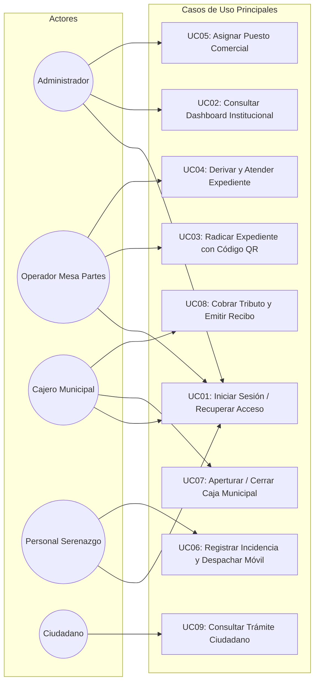
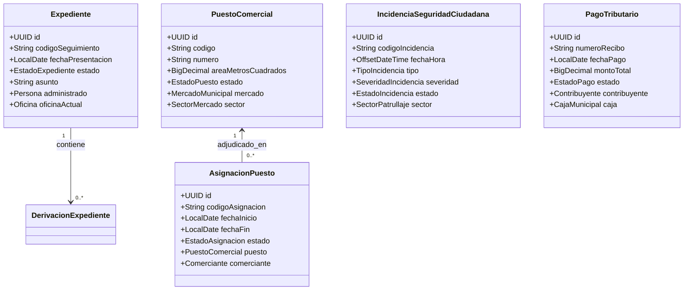
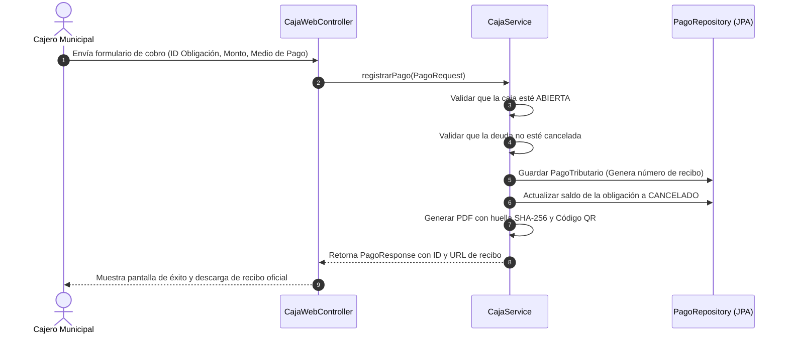

# DIAGRAMAS UML — MODELADO ORIENTADO A OBJETOS SIGM-QUINUA

## 1. DIAGRAMA DE CASOS DE USO GENERAL

---

## 2. DIAGRAMA DE CLASES DEL DOMINIO PRINCIPAL

---

## 3. DIAGRAMA DE SECUENCIA: REGISTRO DE PAGO EN CAJA

